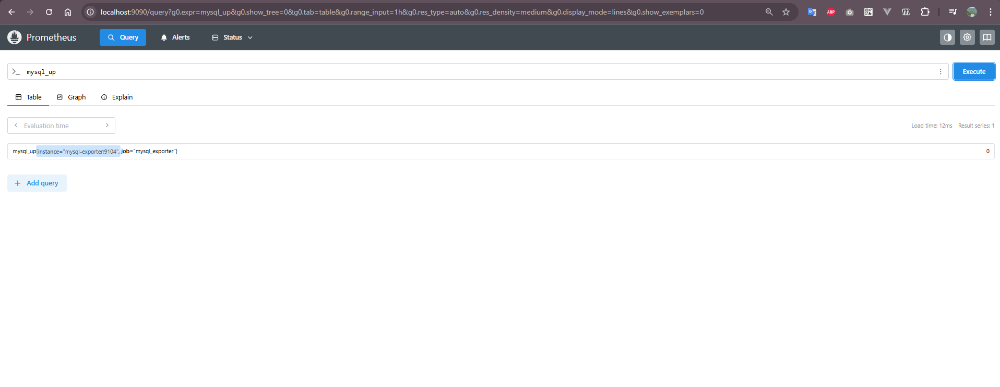
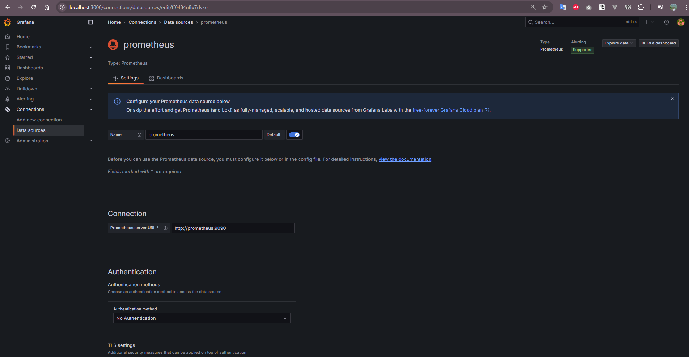
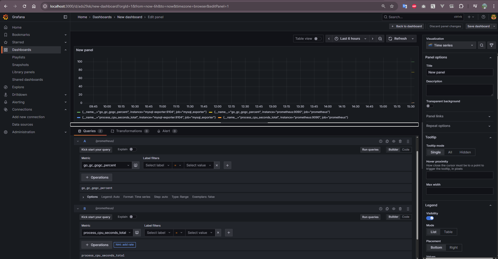

# 📊 MySQL Monitoring Stack (Docker Compose)

Monitoring system MySQL with **Prometheus**, **Grafana**, và **mysqld-exporter**.

---

## 🧩 1. System

| Service | Actions |
|----------|----------|
| **mysql** | Main Database, storage monitoring |
| **mysqld-exporter** | Collect data metrics from MySQL and expose to Prometheus |
| **prometheus** | Storage and query metrics |
| **grafana** | Virualization dashboard |

---

## ⚙️ 2. Folder

```

project/
│
├── docker-compose.yml
├── prometheus.yml
├── .my.cnf
└── grafana/
└── provisioning/
└── datasources/

````

---

## 🧾 3. Nội dung các file chính

### `.my.cnf`
```ini
[client]
user=root
password=password
````

### `prometheus.yml`

```yaml
global:
  scrape_interval: 5s

scrape_configs:
  - job_name: 'prometheus'
    static_configs:
      - targets: ['prometheus:9090']

  - job_name: 'mysql_exporter'
    static_configs:
      - targets: ['mysql-exporter:9104']
```
Docker using <service>:<post> (prometheus:9090, mysql-exporter:9104) instead localhost:<post>

### `docker-compose.yml`

```yaml
version: '3'
services:

  mysql:
    image: mysql
    container_name: mysql
    restart: always
    environment:
      MYSQL_DATABASE: 'test'
      MYSQL_USER: 'sample'
      MYSQL_PASSWORD: 'password'
      MYSQL_ROOT_PASSWORD: 'password'
    ports:
      - '3306:3306'
    volumes:
      - ./mysql-db:/var/lib/mysql

  mysql-exporter:
    image: prom/mysqld-exporter
    container_name: mysql-exporter
    depends_on:
      - mysql
    command:
      - --config.my-cnf=/cfg/.my.cnf
      - --mysqld.address=mysql:3306
    volumes:
      - "./.my.cnf:/cfg/.my.cnf"
    ports:
      - 9104:9104

  prometheus:
    image: prom/prometheus
    container_name: prometheus
    volumes:
      - "./prometheus.yml:/etc/prometheus/prometheus.yml"
    ports:
      - 9090:9090

  grafana:
    image: grafana/grafana
    container_name: grafana
    ports:
      - 3000:3000
    restart: unless-stopped
    environment:
      - GF_SECURITY_ADMIN_USER=admin
      - GF_SECURITY_ADMIN_PASSWORD=admin
    volumes:
      - ./grafana:/etc/grafana/provisioning/datasources
```

---

## 🚀 4. Run

```bash
docker compose up -d
```

Kiểm tra container:

```bash
docker ps
```

---

## 🔍 5. Monitoring

| System | URL                                                            | Actions                                          |
| ---------- | -------------------------------------------------------------- | ------------------------------------------------ |
| Prometheus | [http://localhost:9090](http://localhost:9090)                 | UI query metrics                          |
| Targets    | [http://localhost:9090/targets](http://localhost:9090/targets) | Status monitoring `mysql_exporter` **UP** |
| Grafana    | [http://localhost:3000](http://localhost:3000)                 | `admin / admin`                        |

---

## 📡 6. Sample Prometheus Queries

| Insight               | Query                                     |
| --------------------- | ----------------------------------------- |
| Check if MySQL is up  | `mysql_up`                                |
| Total queries handled | `mysql_global_status_questions`           |
| Current connections   | `mysql_global_status_threads_connected`   |
| Query rate per second | `rate(mysql_global_status_questions[1m])` |
| Prometheus build info | `prometheus_build_info`                   |


### Test Prometheus 

---

## 📊 7. Configure Grafana

### 🧱 Step 1: Add Prometheus as Data Source

Go to Grafana → **Connections → Data Sources → Add Data Source → Prometheus**

* **Name:** `prometheus`
* **URL:** `http://prometheus:9090`
* **Auth:** No Authentication

> Save & Test — should show *Data source is working*.


---

### 📈 Step 2: Create a Dashboard

1. Go to **Dashboards → New Dashboard → Add Visualization**
2. Choose the Prometheus data source
3. Example metrics:

   * `go_gc_gogc_percent`
   * `process_cpu_seconds_total`
4. Add more panels or import an existing one.


---

### 🧩 Optional: Import Ready-made Dashboards

You can import community dashboards directly from [Grafana.com](https://grafana.com/grafana/dashboards/):

* **ID 7362** – MySQL Overview
* **ID 9628** – MySQL Performance

---

## 🧠 Notes

* Prometheus **does not store MySQL table data**, only metrics.
* For SQL queries like `SELECT * FROM employees;`, use:

  * MySQL CLI
  * Grafana’s MySQL data source plugin
* The `mysql-db` folder persists data even after container restarts.

---

## 🧹 9. Stop & Remove Containers

```bash
docker compose down
```