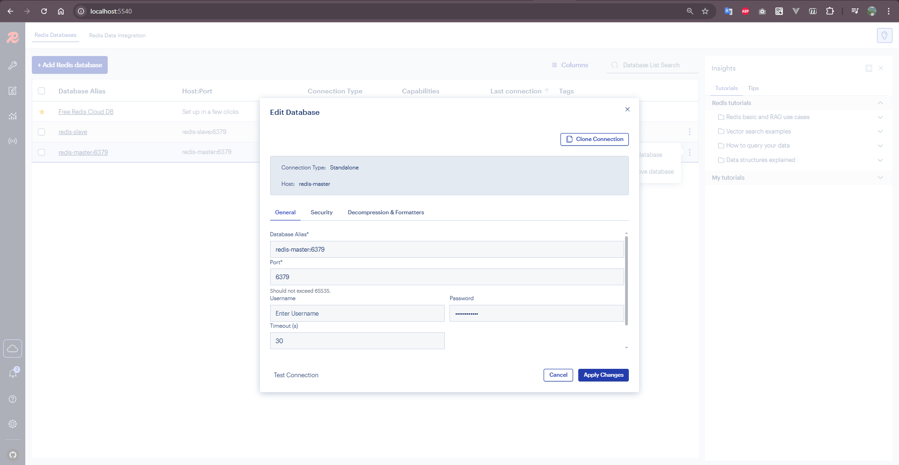
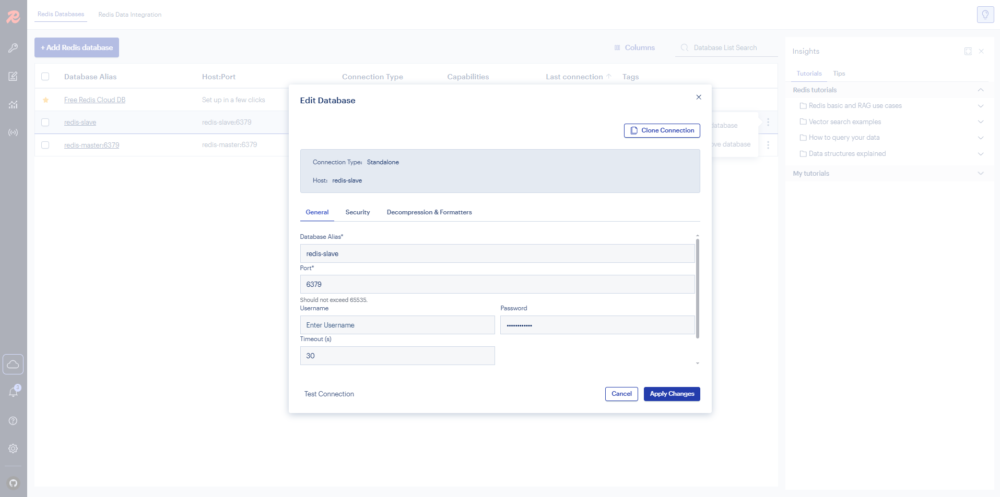
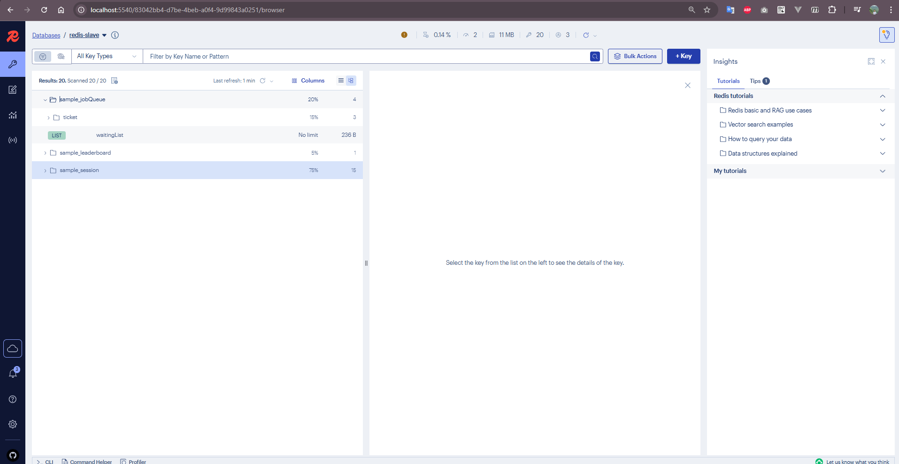

# Redis Master-Slave Setup with Docker

This project demonstrates a Redis master-slave replication setup using Docker Compose. It includes a Redis master instance, a Redis slave (replica) instance, and RedisInsight for database management and monitoring.

## Architecture Overview

The setup consists of:
- **Redis Master**: Primary database for write operations (port 6379)
- **Redis Slave**: Read-only replica for read operations (port 6479)
- **RedisInsight**: Web-based GUI for Redis management (port 5540)

## Quick Start

### Prerequisites
- Docker and Docker Compose installed
- Basic understanding of Redis concepts

### Running the Setup

1. **Clone and navigate to the project directory**
   ```bash
   cd redis-master-slave
   ```

2. **Start the services**
   ```bash
   docker-compose up -d
   ```

3. **Verify all containers are running**
   ```bash
   docker-compose ps
   ```

## Configuration Details

### Master Configuration (`redis-master.conf`)
- **Persistence**: AOF (Append Only File) enabled for data durability
- **Memory Management**: 512MB max memory with LRU eviction policy
- **Security**: Password protection and dangerous commands disabled
- **Performance**: Optimized for write operations

### Slave Configuration (`redis-slave.conf`)
- **Replication**: Automatically syncs with master
- **Read-Only**: Optimized for read operations
- **No Persistence**: Reduces write load on slave
- **Authentication**: Uses master password for replication

## Connection Guide

### Connecting to Redis Master


**Connection Details:**
- **Host**: `localhost`
- **Port**: `6379`
- **Password**: `yourStrongPassword123`
- **Use Case**: Write operations, data persistence

### Connecting to Redis Slave


**Connection Details:**
- **Host**: `localhost`
- **Port**: `6479`
- **Password**: `yourStrongPassword123`
- **Use Case**: Read operations, load balancing

### RedisInsight Web Interface


**Access RedisInsight:**
- **URL**: `http://localhost:5540`
- **Pre-configured connections**: Both master and slave are pre-loaded
- **Features**: Data browsing, query execution, performance monitoring

## Testing Replication

### 1. Write to Master
```bash
# Connect to master
docker exec -it redis-master redis-cli -a yourStrongPassword123

# Set some test data
SET user:1 "John Doe"
SET user:2 "Jane Smith"
SET counter 100
```

### 2. Read from Slave
```bash
# Connect to slave
docker exec -it redis-slave redis-cli -a yourStrongPassword123

# Read the same data (should be replicated)
GET user:1
GET user:2
GET counter
```

### 3. Verify Replication Status
```bash
# Check master replication info
docker exec -it redis-master redis-cli -a yourStrongPassword123 INFO replication

# Check slave replication info
docker exec -it redis-slave redis-cli -a yourStrongPassword123 INFO replication
```

## Service Management

### Start Services
```bash
docker-compose up -d
```

### Stop Services
```bash
docker-compose down
```

### View Logs
```bash
# All services
docker-compose logs

# Specific service
docker-compose logs redis-master
docker-compose logs redis-slave
```

### Restart Services
```bash
docker-compose restart
```

## Monitoring and Management

### RedisInsight Features
- **Real-time monitoring**: CPU, memory, and network usage
- **Data visualization**: Browse keys and values
- **Query execution**: Run Redis commands
- **Performance metrics**: Monitor replication lag
- **Connection management**: Switch between master and slave

### Command Line Monitoring
```bash
# Monitor Redis commands in real-time
docker exec -it redis-master redis-cli -a yourStrongPassword123 MONITOR

# Check replication status
docker exec -it redis-master redis-cli -a yourStrongPassword123 INFO replication
```

## Production Considerations

### Security
- Change default passwords in configuration files
- Use Docker secrets for sensitive data
- Implement network security policies
- Enable SSL/TLS for production environments

### Performance
- Adjust memory limits based on your requirements
- Configure appropriate eviction policies
- Monitor replication lag
- Consider Redis Sentinel for high availability

### Backup Strategy
- Master handles persistence (AOF enabled)
- Regular backups of master data
- Test backup restoration procedures
- Consider Redis Cluster for horizontal scaling

## Troubleshooting

### Common Issues

1. **Slave not connecting to master**
   - Check network connectivity between containers
   - Verify master password in slave configuration
   - Ensure master is running before starting slave

2. **Data not replicating**
   - Check replication status: `INFO replication`
   - Verify slave is in read-only mode
   - Check for network issues between containers

3. **Memory issues**
   - Monitor memory usage: `INFO memory`
   - Adjust `maxmemory` settings
   - Check eviction policies

### Useful Commands
```bash
# Check container status
docker-compose ps

# View container logs
docker-compose logs -f redis-master

# Execute Redis CLI
docker exec -it redis-master redis-cli -a yourStrongPassword123

# Check replication info
docker exec -it redis-master redis-cli -a yourStrongPassword123 INFO replication
```

## File Structure
```
redis-master-slave/
├── docker-compose.yml      # Docker services configuration
├── redis-master.conf       # Master Redis configuration
├── redis-slave.conf        # Slave Redis configuration
├── images/                 # Documentation images
│   ├── image.png          # Master connection example
│   ├── image1.png         # Slave connection example
│   └── image2.png         # RedisInsight interface
└── README.md              # This documentation
```
