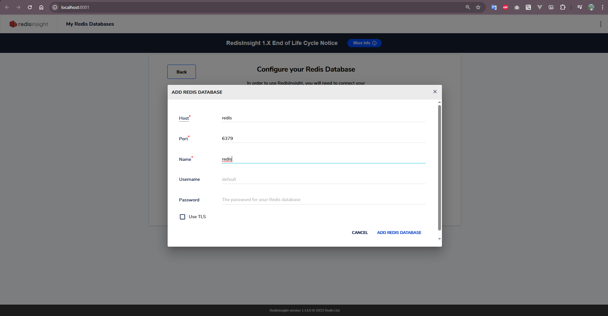
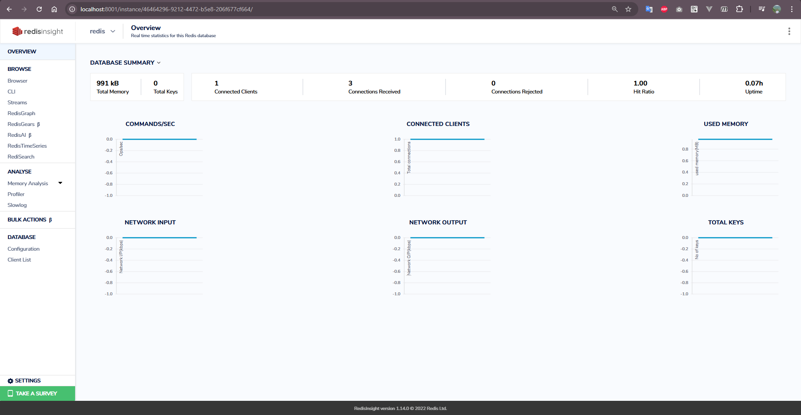

# Redis Stack with Docker and RedisInsight

A complete Redis development environment with Docker Compose, featuring Redis 7.2 and RedisInsight for database management.

## 🚀 Overview

**Redis**: In-memory data structure store with password protection, persistence (RDB + AOF), and 512MB memory limit with LRU eviction.

**Docker**: Containerized setup for easy deployment, isolation, and portability.

**RedisInsight**: Web-based GUI for Redis with database browser, query interface, and performance monitoring.

## 📊 RedisInsight UI Screenshots



*RedisInsight provides an intuitive web interface for managing your Redis databases*



*Explore your Redis data structures with the built-in database browser*

## 🚀 Quick Start

1. **Start services**
   ```bash
   docker-compose up -d
   ```

2. **Access RedisInsight**
   - Navigate to `http://localhost:8001`
   - Add database connection:
     - Host: `redis`
     - Port: `6379`
     - Password: `yourStrongPassword123`

3. **Connect to Redis**
   ```bash
   docker exec -it redis redis-cli -a yourStrongPassword123
   ```

## 🔧 Services

| Service | Image | Port | Description |
|---------|-------|------|-------------|
| redis | redis:7.2 | 6379 | Redis database server |
| redis_insight | redislabs/redisinsight:1.14.0 | 8001 | RedisInsight web interface |

## 📝 Basic Usage

```bash
# Redis commands
SET mykey "Hello Redis"
GET mykey
SETEX session:123 3600 "user_data"
KEYS *
```

## 🐛 Troubleshooting

```bash
# Check status
docker-compose ps

# View logs
docker-compose logs redis
docker-compose logs redis_insight

# Restart
docker-compose restart
```